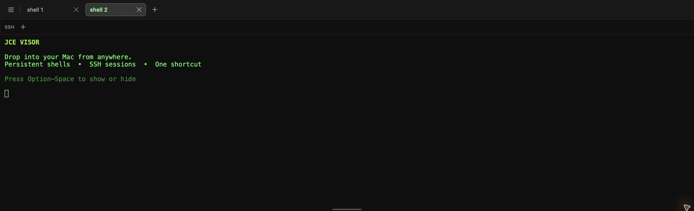
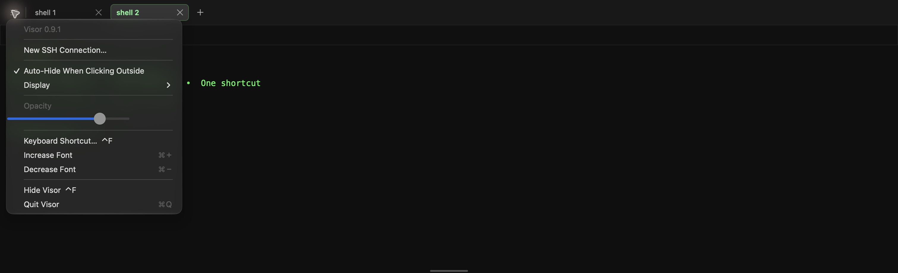

<p align="center">
  
</p>

<h1 align="center">JCE Visor for macOS</h1>

<p align="center"><strong>A fast, lightweight drop-down terminal for macOS.</strong></p>

JCE Visor is a fast, lightweight drop-down terminal for macOS. Press **Option–Space** to smoothly summon persistent shell and SSH sessions from any screen, then click outside the panel when you want it out of the way. Your sessions keep running while JCE Visor is hidden.

Visor is currently a prerelease app. Version 1.0 release preparation, signing, and notarization are in progress.



## Download

**Xcode is not required to run JCE Visor.** Regular users will download the finished `Visor.app` from the [Releases page](../../releases), move it to Applications, and launch it like any other Mac app.

The first signed release is still being prepared. Xcode or Apple command-line developer tools are only required when building JCE Visor from source.

## Run it

Requirements: macOS 14 or later and Xcode 16 or later.

```sh
swift run Visor
```

On first launch, the panel opens automatically. Visor appears in the Dock and macOS Force Quit window; use Command-Q or the Visor application menu to quit. Use the plus button in the top bar for a new shell. Each tab keeps its own complete terminal state, including alternate-screen programs such as Vim, `less`, and remote SSH tools. When you run `ssh` in a shell tab, the tab adopts the destination device name and returns to its previous name when the SSH session ends. Add saved SSH connections from the slim SSH bookmark bar, then click a bookmark to connect. Right-click a bookmark to choose or generate an SSH key, add its passphrase to macOS Keychain through `ssh-add`, install its public key on the server, test key-only login, edit the connection, or delete it. Private keys stay in `~/.ssh`; Visor stores only the identity-file path, and passwords and key passphrases stay with OpenSSH and macOS Keychain. Open Settings to record a different global show/hide shortcut, disable automatic hiding, or lock Visor to a specific connected display. Drag the thin handle at the bottom to resize the panel.

Visor supports normal macOS Command-C, Command-V, Command-A, and Command-K shortcuts. Paste uses terminal bracketed-paste mode when the active shell or remote program requests it. Keyboard modes, modified keys, mouse reporting, binary terminal input, Unicode input, true color, resizing, and terminal bells are handled by the bundled xterm-compatible terminal engine.

## Build and test

Build a release executable:

```sh
swift build -c release
```

The binary is written to `.build/release/Visor`.

Run the test suite:

```sh
swift test
```

To make a locally signed app you can open from Finder:

```sh
./scripts/build-app.sh
open outputs/Visor.app
```

## Project status

The app includes a customizable global shortcut, persistent shell and SSH sessions, saved SSH bookmarks, independent terminal state per tab, multi-display placement, configurable auto-hide, panel sizing, translucency, and a green-on-black terminal. Terminal input and VT rendering use a locally bundled xterm.js runtime.

The remaining version 1.0 work is tracked in [PLAN.md](PLAN.md). Distribution signing and notarization require an Apple Developer Program signing identity and are intentionally separate from local development builds.

## Settings

JCE Visor lets you control automatic hiding, lock the panel to a chosen display, adjust opacity, change the global shortcut, and resize terminal text.



## Third-party software

The bundled terminal renderer is based on xterm.js. Its license and the fit add-on license are included with the vendored resources in `Sources/Visor/Resources/vendor/`.
